# Agentic Engineering Platform (AEP)

## Enterprise Multi-Agent Platform for Autonomous Software Engineering

**Agentic Engineering Platform (AEP)** is an enterprise-oriented multi-agent AI platform designed to autonomously analyze software repositories, identify engineering opportunities, and execute software engineering workflows across **architecture, security, code quality, performance, testing, optimization, refactoring, and Jira automation**.

The platform combines **LLM-based task decomposition, dependency-aware multi-agent orchestration, Deep Agents, LangGraph, MCP, sandboxed execution, AI guardrails, persistent memory, artifact-based state management, and LangSmith observability** into a unified agent execution platform.

The objective is to move beyond standalone AI assistants toward a **controlled, observable, extensible, and production-oriented AI engineering platform**.

---

## Table of Contents

- [1. What Problem Does AEP Solve?](#1-what-problem-does-aep-solve)
- [2. Core Capabilities](#2-core-capabilities)
- [3. AWS & Multi-Cloud Architecture](#3-aep--aws--multi-cloud-architecture)
- [4. LLM-Based Router](#4-llm-based-router)
- [5. Dependency-Aware Orchestration](#5-dependency-aware-orchestration)
- [6. AI Execution Harness](#6-ai-execution-harness)
- [7. AI Sandbox](#7-ai-sandbox)
- [8. AI Governance, Security & Runtime Controls](#8-ai-governance-security--runtime-controls)
- [9. MCP Integration Overview](#9-mcp-integration-overview)
- [10. Stateful Agents & Persistent Memory Architecture](#10-stateful-agents--persistent-memory-architecture)
- [11. Workflow State & Agent Context Management](#11-workflow-state--agent-context-management)
- [12. Artifact-Based Agent Communication](#12-artifact-based-agent-communication)
- [13. MCP Management Infrastructure](#13-mcp-management-infrastructure)
- [14. Reliability, Resilience & Failure Recovery](#14-reliability-resilience--failure-recovery)
- [15. Observability, LLM Gateway & Monitoring](#15-observability-llm-gateway--monitoring)
- [16. End-to-End Agent Execution Lifecycle](#16-end-to-end-agent-execution-lifecycle)
- [17. Technology Stack & Infrastructure](#17-technology-stack--infrastructure)
- [18. Key Architectural Principles](#18-key-architectural-principles)
- [19. Project Outcomes & Engineering Impact](#19-project-outcomes--engineering-impact)
- [20. Project Highlights](#20-project-highlights)
- [21. AEP at a Glance](#21-aep-at-a-glance)
- [Local Setup and Execution](#local-setup-and-execution)
- [Project Structure](#project-structure)

---

## 1. What Problem Does AEP Solve?

Traditional AI coding assistants generally operate as a single conversational agent.

A complex software-engineering task, however, may require multiple capabilities:

```text
Repository Discovery
        ↓
Architecture Analysis
        ↓
Security Analysis
        ↓
Code Review
        ↓
Performance Analysis
        ↓
Testing
        ↓
Optimization / Refactoring
        ↓
Jira / Engineering Workflow
```

Many of these activities have dependencies.

For example:

```text
Repository Discovery
        ↓
Architecture Analysis
        ↓
Security Analysis
        ↓
Code Review
        ↓
Optimization
```

Some activities can execute independently:

```text
                 ┌── Security Agent
                 │
Repository ──────┼── Code Review Agent
                 │
                 ├── Performance Agent
                 │
                 └── Testing Agent
```

AEP addresses this by dynamically determining **which agents are required, which agents can execute in parallel, and which agents must wait for other agents to complete**.

---

## 2. Core Capabilities

### Multi-Agent Orchestration

- LLM-based task decomposition and routing
- Dependency-aware agent execution
- DAG-based workflow orchestration
- Dynamic route generation
- Parallel agent execution
- Fan-out / fan-in execution patterns
- Stateful workflow execution

### Software Engineering Agents

AEP supports specialized agents for:

- Repository Discovery
- Architecture Analysis
- Security Analysis
- Code Review
- Performance Analysis
- Testing
- Code Engineering
- Optimization
- Refactoring
- Jira Workflow Automation

These agents can be composed into larger engineering workflows rather than operating independently.

---

## 3. AEP – AWS & Multi-Cloud Architecture

AEP uses a containerized, multi-agent architecture integrating AWS infrastructure, Azure Blob Storage, GitHub tools, and the Portkey LLM Gateway. It combines agent orchestration, persistent memory, external tool execution, checkpointing, human-in-the-loop approvals, and artifact management.

```mermaid
flowchart TB

    USER["Users / Developers"]

    subgraph AWS["AWS Cloud - us-east-1"]
        
        IGW["Internet Gateway"]

        subgraph VPC["VPC - 172.31.0.0/16"]

            subgraph PUBLIC_A["Public Subnet - us-east-1a<br/>172.31.0.0/20"]
                UI["Amazon ECS Fargate<br/>Streamlit UI<br/>Port 8501<br/>aep-ui-task"]
            end

            subgraph PUBLIC_C["Public Subnet - us-east-1c<br/>172.31.16.0/20"]
                API["Amazon ECS Fargate<br/>FastAPI Backend<br/>Port 8000<br/>aep-api-task"]

                subgraph AGENT_PLATFORM["AEP Agentic Execution Platform"]
                    ROUTER["Intelligent Router"]
                    ORCH["LangGraph Orchestrator<br/>Execution Director"]

                    subgraph AGENTS["Specialist Agent Layer"]
                        REPO["Repository Discovery Agent"]
                        ARCH["Architecture Analysis Agent"]
                        SEC["Security Analysis Agent"]
                        QUALITY["Code Review / Quality Agent"]
                        PERF["Performance Analysis Agent"]
                        TEST["Testing Agent"]
                        CODE["Code Engineering Agent"]
                        OPT["Optimization Agent"]
                        REFACTOR["Refactoring Agent"]
                        JIRA["Jira Workflow Agent"]
                    end

                    HARNESS["AI Execution Harness<br/>Sandbox • HITL • Guardrails<br/>Checkpointing & Recovery"]

                    MCP["MCP Manager<br/>Tool Discovery • Caching<br/>Connection Pooling"]
                end
            end

            subgraph PRIVATE_DB["Private RDS Subnets"]
                RDS["Amazon RDS PostgreSQL 17<br/>aep-postgres<br/>Port 5432"]

                subgraph MEMORY["Persistent Memory & State"]
                    EPISODIC["Episodic Memory<br/>Execution & Interaction History"]
                    SEMANTIC["Semantic Memory<br/>User Preferences & Context"]
                    PROCEDURAL["Procedural Memory<br/>Agent Skills & Instructions"]
                    CHECKPOINT["LangGraph Checkpointer<br/>Thread State & Recovery"]
                end
            end

            SSM["SSM Session Manager<br/>EC2 Tunnel Access"]
        end

        subgraph AWS_SERVICES["AWS Supporting Services"]
            ECR["Amazon ECR<br/>AEP UI & API Images"]
            IAM["AWS IAM<br/>Execution Role & Task Role"]
            CW["Amazon CloudWatch<br/>Application Logs"]
            SM["AWS Secrets Manager<br/>Database Credentials"]
        end
    end

    subgraph EXTERNAL["External Services & Integrations"]
        PORTKEY["Portkey LLM Gateway"]
        LLM["OpenAI / Configured LLM Providers"]
        GITHUB["GitHub Tools"]
        AZURE["Azure Blob Storage<br/>Agent Outputs & Artifacts"]
    end

    USER --> IGW
    IGW --> UI
    UI -->|"HTTP API - Port 8000"| API

    API --> ROUTER
    ROUTER --> ORCH

    ORCH --> REPO
    ORCH --> ARCH
    ORCH --> SEC
    ORCH --> QUALITY
    ORCH --> PERF
    ORCH --> TEST
    ORCH --> CODE
    ORCH --> OPT
    ORCH --> REFACTOR
    ORCH --> JIRA

    AGENTS --> HARNESS
    HARNESS --> MCP

    MCP -->|"MCP Tool Calls"| GITHUB

    ORCH -->|"LLM Requests"| PORTKEY
    PORTKEY --> LLM

    HARNESS -->|"Store / Retrieve Artifacts"| AZURE

    API --> RDS
    RDS --> EPISODIC
    RDS --> SEMANTIC
    RDS --> PROCEDURAL
    RDS --> CHECKPOINT

    USER -.->|"Feedback & Preferences"| SEMANTIC
    USER -.->|"Interaction History"| EPISODIC

    ECR -.->|"Container Images"| UI
    ECR -.->|"Container Images"| API

    IAM -.-> UI
    IAM -.-> API
    API -.-> CW
    API -.-> SM

    SSM -.->|"Secure Port Forwarding"| RDS

```




```text
                         User Request
                              │
                              ▼
                    ┌───────────────────┐
                    │      LLM Router   │
                    │   RouteDecision   │
                    └─────────┬─────────┘
                              │
                              ▼
                    ┌───────────────────┐
                    │   Orchestrator    │
                    │                   │
                    │ Dependency / DAG  │
                    │     Resolution    │
                    └─────────┬─────────┘
                              │
                       Ready Routes
                              │
                              ▼
                    ┌───────────────────┐
                    │     Fan-Out       │
                    │ Parallel Agents   │
                    └─────────┬─────────┘
                              │
              ┌───────────────┼────────────────┐
              │               │                │
              ▼               ▼                ▼
        Security Agent   Code Review      Performance
              │               │                │
              └───────────────┼────────────────┘
                              │
                              ▼
                    ┌───────────────────┐
                    │    AI Harness     │
                    │                   │
                    │ Agent Runtime     │
                    │ Sandbox           │
                    │ Guardrails        │
                    │ Memory            │
                    │ MCP Tools         │
                    │ Middleware        │
                    │ State Tracking    │
                    └─────────┬─────────┘
                              │
                              ▼
                       Agent Artifacts
                              │
                              ▼
                    ┌───────────────────┐
                    │     Fan-In        │
                    │ Result Aggregation│
                    └─────────┬─────────┘
                              │
                              ▼
                       Orchestrator
                              │
                              ▼
                             End
```

---

## 4. LLM-Based Router

The AEP Router converts a natural-language engineering request into a structured routing decision.

The Router uses an LLM with structured output:

```python
structured_llm = llm_openai.with_structured_output(
    RouteDecision
)
```

The resulting route information is passed to the orchestration layer.

```text
User Request
     │
     ▼
   LLM
     │
     ▼
RouteDecision
     │
     ├── Agent
     ├── Task
     ├── Route ID
     └── Dependencies
```

This provides a structured interface between **natural-language intent and deterministic workflow orchestration**.

---

## 5. Dependency-Aware Orchestration

The Execution Orchestrator evaluates agent dependencies and determines which routes are ready for execution.

AEP supports:

- Dependency resolution
- Ready-route identification
- Sequential execution where dependencies exist
- Parallel execution for independent agents
- Fan-out
- Fan-in
- State propagation
- Iterative orchestration

Example:

```text
                    Repository Discovery
                           │
                           ▼
                    Architecture Agent
                           │
              ┌────────────┼────────────┐
              ▼            ▼            ▼
          Security      Code Review   Performance
              │            │            │
              └────────────┼────────────┘
                           ▼
                    Optimization
                           │
                           ▼
                       Refactoring
```

Independent routes are dispatched using LangGraph's dynamic `Send` mechanism.

---

## 6. AI Execution Harness

A core component of AEP is the **AI Harness**.

The AI Harness provides a standardized runtime around every agent.

It manages:

```text
Agent
 │
 ├── Model
 ├── Tools
 ├── MCP Sessions
 ├── Memory
 ├── Context
 ├── Sandbox
 ├── Permissions
 ├── Middleware
 ├── HITL
 ├── Execution Limits
 ├── Checkpointing
 ├── State Tracking
 └── Artifact Persistence
```

The Deep Agent runtime is configured with the model, composite backend, middleware, subagents, persistent store, checkpointing, MCP tools, filesystem permissions, and memory paths.

This allows individual agents to focus on their engineering task while the platform manages the surrounding execution infrastructure.

---

## 7. AI Sandbox

AEP provides isolated execution through **LangSmith Sandbox**.

The sandbox is used as the default execution backend for Deep Agents.

```text
Deep Agent
     │
     ▼
Composite Backend
     │
     ├── Sandbox
     ├── Shared Memory
     ├── Personal Memory
     └── Skills
```

The platform also controls filesystem access through explicit permissions.

Example controlled paths include:

```text
/memories/personal/
/memories/shared/LEARNINGS.md
```

The sandbox lifecycle is managed by the platform, including creation and cleanup after execution.

### Benefits

- Isolated agent execution
- Controlled filesystem access
- Separation between agent runtime and application environment
- Explicit resource permissions
- Ephemeral execution environment
- Automated sandbox cleanup

---

## 8. AI Governance, Security & Runtime Controls

AEP implements a layered governance and security architecture designed to provide controlled autonomy across multi-agent engineering workflows.

Rather than relying exclusively on individual agent prompts, AEP applies platform-level controls around agent execution, model interactions, tool invocation, filesystem access, sensitive information handling, and workflow state.

The governance architecture combines execution isolation, human oversight, permission enforcement, middleware-based controls, context management, and observability.

### 8.1 AI Execution Governance – Execution Harness

The AI Execution Harness provides a standardized runtime around individual agents.

It coordinates:

- Model execution
- Tool invocation
- MCP sessions
- Memory and context
- Sandbox execution
- Filesystem permissions
- Middleware
- Human-in-the-loop approvals
- Model and tool call limits
- Checkpointing and state tracking
- Artifact persistence

This separates agent-specific engineering logic from platform-level execution controls.

### 8.2 Isolated Agent Execution – AI Sandbox

AEP uses LangSmith Sandbox as the default execution backend for Deep Agents. The sandbox lifecycle—including creation, isolated execution, and cleanup—is managed by the platform. Filesystem permissions and CompositeBackend routing define access to the configured sandbox and memory resources; see [Section 7 – AI Sandbox](#7-ai-sandbox) for the sandbox architecture.

### 8.3 Human-in-the-Loop – Human Oversight

AEP integrates HumanInTheLoopMiddleware to introduce human approval into potentially destructive tool operations.

The approval lifecycle supports:

1. Agent selects a tool.
2. The configured middleware evaluates whether approval is required.
3. Execution is interrupted when human review is required.
4. The user reviews the requested operation and its arguments.
5. The user approves or rejects the operation.
6. The workflow resumes with the corresponding decision.

This provides a human oversight mechanism for sensitive tool operations rather than allowing every action to execute autonomously.

### 8.4 Tool Access and Filesystem Governance

AEP applies explicit filesystem permissions to control which resources agents can access.

Configured access boundaries include personal memory, shared memory, skills, and sandbox resources.

Tool execution is integrated through the MCP management layer, which manages server connections, tool discovery, caching, session acquisition, and release.

This creates a centralized infrastructure boundary for external tool integration.

### 8.5 PII Protection – Middleware-Based Email Masking

AEP integrates LangChain PIIMiddleware for email PII handling.

Current configuration:

| Configuration | Implementation |
|---|---|
| PII type | Email |
| Strategy | Mask |
| Model input | Enabled |
| Model output | Enabled |
| Tool results | Disabled |

The middleware masks detected email addresses in model inputs and outputs.

**Scope:** The current implementation specifically handles email addresses. It should not be interpreted as comprehensive PII detection or enterprise-wide data-loss prevention.

### 8.6 Model Reliability – Model Retry Middleware

AEP uses ModelRetryMiddleware to handle retryable model failures.

Current configuration:

- Maximum retries: 3
- Backoff factor: 2.0
- Initial delay: 1 second
- Retry classification: Framework default retryable errors
- Final failure behavior: Return an error

Exponential backoff helps avoid immediate repeated model requests when transient failures occur.

### 8.7 Tool Reliability – Retry and Error Middleware

AEP uses two complementary middleware mechanisms for tool execution.

**ToolRetryMiddleware**

- Maximum retries: 3
- Retryable exceptions: ConnectionError and TimeoutError
- Backoff factor: 2.0
- Initial delay: 2 seconds
- Maximum delay: 60 seconds
- Jitter: Enabled
- Final failure behavior: Return an error

**ToolErrorMiddleware**

The custom error handler processes ValueError and FileNotFoundError exceptions.

It generates tool-specific feedback instructing the agent to review the failure, correct its arguments, or select an alternative approach.

This allows the agent to receive actionable failure information rather than only an unstructured exception.

### 8.8 Execution Limits and Guardrails

AEP configures model-call and tool-call limits to control agent execution.

Combined with approval middleware and filesystem permissions, these controls provide boundaries around agent autonomy.

### 8.9 Context Governance and Context Engineering

Long-running agent executions can accumulate substantial conversational and tool context.

AEP uses context-management mechanisms including:

- Context summarization
- Context editing
- Tool-output management
- Relevant context injection

These mechanisms help manage context growth and maintain relevant information during extended workflows.

### 8.10 Stateful Execution and Recovery

AEP uses LangGraph checkpointing and persistent storage to maintain workflow execution state.

This supports interrupted workflows, human approval and subsequent execution resumption.

MCP session recovery mechanisms also help manage broken tool sessions through session detection, disposal and replacement.

### 8.11 AI Observability

AEP integrates LangSmith to provide visibility into agent execution and model/tool interactions.

This supports inspection of multi-agent execution paths and troubleshooting across complex workflows.

### Governance Architecture Summary

| Domain | Implemented mechanism |
|---|---|
| Execution governance | AI Execution Harness |
| Execution isolation | LangSmith Sandbox |
| Human oversight | HumanInTheLoopMiddleware |
| PII protection | PIIMiddleware – email masking |
| Tool reliability | ToolRetryMiddleware |
| Tool error handling | ToolErrorMiddleware |
| Model reliability | ModelRetryMiddleware |
| Filesystem governance | Explicit filesystem permissions |
| Execution boundaries | Model/tool call limits |
| Context governance | Context editing and summarization |
| Stateful recovery | LangGraph checkpointing |
| Tool session recovery | MCP session lifecycle management |
| Observability | LangSmith |

**Design principle:** AEP separates agent autonomy from execution authority. Agents can reason and perform engineering tasks, while platform-level mechanisms govern access, approvals, execution boundaries, failure handling, and state recovery.
---

## 9. MCP Integration Overview

AEP uses a centralized MCP Management Layer to connect specialist agents with external tools and services. The `MCPManager` provides shared connection management, tool discovery and caching, asynchronous session handling, connection pooling, and session recovery.

The detailed architecture, connection-pooling design, lifecycle management, and agent integration are documented in [Section 13 – MCP Management Infrastructure](#13-mcp-management-infrastructure).

---

## 10. Stateful Agents & Persistent Memory Architecture

AEP implements persistent memory to support context-aware agent execution across workflows and user interactions. The memory architecture separates three logical memory categories, backed by Amazon RDS PostgreSQL. LangGraph checkpointing is maintained as a separate execution-state mechanism.

### 10.1 Episodic Memory

Episodic memory maintains the historical record of agent executions and user interactions.

The stored information includes:

- User ID
- Thread ID
- Task information
- Agent information
- Interaction messages
- Artifact references
- Execution timestamp

It supports execution-history retention, interaction continuity, and access to relevant information from previous workflows.

### 10.2 Semantic Memory

Semantic memory stores reusable information and user-specific knowledge that may be relevant to future executions.

Examples include:

- User preferences
- Reusable contextual information
- Persistent knowledge derived from relevant interactions
- Information retrieved to provide context for subsequent tasks

AEP supports updating episodic and semantic memory based on relevant user interactions and preferences.

### 10.3 Procedural Memory

Procedural memory stores reusable instructions and procedures that guide agent execution.

Examples include:

- Agent skills
- `SKILL.md` instructions
- `AGENTS.md` instructions
- Reusable execution procedures
- Domain-specific agent guidance

This allows agents to reuse established procedures instead of reconstructing their operating instructions for every execution.

### 10.4 LangGraph Checkpointing

In addition to the three memory categories, AEP uses LangGraph checkpointing with PostgreSQL persistence to maintain workflow execution state.

Checkpointing supports:

- Thread-level state persistence
- Interrupted workflow execution
- Human-in-the-loop approval and resumption
- Recovery of stateful agent workflows

Checkpointing is distinct from episodic, semantic, and procedural memory. It preserves workflow state rather than serving as a substitute for long-term knowledge storage.

### 10.5 Persistence Responsibilities

| Persistence mechanism | Stored information | Responsibility |
|---|---|---|
| Episodic memory | Execution and interaction history | Retains information about past executions |
| Semantic memory | Reusable knowledge and preferences | Provides relevant knowledge to future executions |
| Procedural memory | Skills and agent instructions | Guides how agents perform tasks |
| LangGraph checkpointer | Workflow/thread state | Supports state persistence and interrupt/resume |

**Storage:** Amazon RDS PostgreSQL backs the memory and checkpointing layer. Detailed agent outputs are stored separately in Azure Blob Storage; artifact communication is described in [Section 12](#12-artifact-based-agent-communication).

### 10.6 Memory Design Principles

1. **Separation of concerns:** Episodic, semantic, and procedural memory serve different purposes.
2. **Persistent context:** Relevant information can be retained across executions.
3. **User-aware memory:** Relevant preferences and interaction history can influence subsequent agent execution.
4. **Reusable knowledge:** Agent skills and instructions provide consistent execution guidance.
5. **State versus memory:** Workflow checkpoints and long-term knowledge are treated as separate concepts.

## 11. Workflow State & Agent Context Management

AEP uses structured state and context management to coordinate information across specialist agents and long-running engineering workflows.

The platform distinguishes **workflow state**—which controls execution progression—from **agent context**—which provides the task-relevant information an agent needs to reason and act.

### 11.1 Workflow State Management

AEP uses LangGraph state management with a custom state schema (`CustomState`). Workflow state maintains the information required by the orchestrator to coordinate execution.

The state supports information such as:

- User and thread information
- Current execution information
- Route and dependency information
- Agent execution status
- Ready routes
- Workflow progress
- Artifact identifiers and references
- Execution metadata

The orchestrator uses this state to determine which routes are ready, track execution progress, and coordinate subsequent workflow steps.

### 11.2 Agent Context Management

Agent context contains the relevant information required by an individual agent to perform its assigned task.

Context can include:

- Original user request
- Agent-specific task instructions
- Relevant outputs from previous agents
- Repository information
- User-specific memory
- Shared memory
- Relevant procedural instructions and skills
- References to previously generated artifacts

Context is assembled according to the requirements of the agent and its position in the workflow. This avoids treating the entire execution history as the context for every agent.

### 11.3 State and Context Boundaries

| Component | Responsibility | Purpose |
|---|---|---|
| Workflow state | Execution metadata and coordination | Controls workflow progression |
| Agent context | Task-relevant information | Enables agent reasoning |
| Persistent memory | Episodic, semantic, and procedural knowledge | Retains reusable information |
| Artifact references | Identifiers for persisted agent outputs | Connects workflow stages to detailed outputs |
| Checkpointer | Workflow snapshots | Enables state persistence and recovery |

### 11.4 Context Construction Across Agents

When a route becomes eligible for execution, the orchestrator provides the specialist agent with the context relevant to its task. This can include the original request, task instructions, relevant memory, repository information, and outputs or artifact references from upstream agents.

The agent's context is therefore scoped to its role in the workflow rather than automatically receiving the complete execution history.

### 11.5 Architectural Benefits

- Keeps orchestration state focused on execution coordination.
- Provides task-relevant context to individual agents.
- Separates runtime state from persistent memory.
- Allows downstream agents to reference upstream outputs without embedding every detailed result in workflow state.
- Supports long-running, multi-stage workflows.

**Design principle:** Workflow state determines execution progression; agent context supplies the information required for task execution. Detailed outputs are persisted and exchanged through the artifact mechanism described in [Section 12](#12-artifact-based-agent-communication).

## 12. Artifact-Based Agent Communication

AEP uses an artifact-driven communication pattern to exchange detailed outputs between specialized agents across multi-stage engineering workflows. This section describes the artifact lifecycle and storage design; Section 11 explains how artifact references fit into workflow state and agent context.

In complex multi-agent execution, agent outputs can contain extensive repository findings, architecture assessments, security reports, code analysis, and execution results.

Passing these complete outputs through every orchestration step can increase state size and consume unnecessary model context.

AEP addresses this through persistent artifact storage and reference-based output propagation.

### 12.1 Artifact Lifecycle

The artifact lifecycle follows this pattern:

1. A specialist agent receives its assigned task and relevant context.
2. The agent executes its workflow using the configured runtime, tools and sandbox.
3. The agent produces a structured execution result.
4. The detailed output is persisted as an artifact.
5. An artifact identifier is associated with the execution state.
6. The orchestrator determines the next eligible agent.
7. The downstream agent retrieves the relevant artifact and uses it as task context.

### 12.2 Artifact Storage Architecture

AEP uses Azure Blob Storage for persistent storage of agent outputs and artifacts.

The architecture separates:

**Artifact Content**
- Detailed repository analysis
- Architecture findings
- Security assessments
- Code quality reports
- Testing results
- Optimization recommendations
- Refactoring outputs

**Artifact References and Metadata**
- Artifact identifiers
- References associated with execution state
- User and thread association where maintained by the application
- Relationships between agent execution and generated outputs

The actual artifact content is stored in Azure Blob Storage, while references are maintained through the platform's state and persistence mechanisms.

### 12.3 Inter-Agent Artifact Communication

Artifacts allow agents to exchange detailed execution results without requiring the complete output to be embedded in every orchestration-state update.

Example:

Repository Discovery Agent
    ↓
Repository Analysis Artifact
    ↓
Azure Blob Storage
    ↓
Artifact Reference
    ↓
Architecture Analysis Agent
    ↓
Architecture Assessment Artifact
    ↓
Security Analysis Agent

Each downstream agent can consume the relevant output produced by an earlier workflow stage.

### 12.4 Benefits of Artifact-Driven Execution

- Reduces unnecessary propagation of large outputs through workflow state.
- Separates artifact persistence from orchestration state.
- Supports detailed information exchange between dependent agents.
- Enables outputs to remain available beyond the immediate agent execution.
- Supports long-running engineering workflows.
- Provides a foundation for traceable, artifact-oriented execution.

**Design principle:** Agents exchange detailed engineering deliverables through persistent artifacts, while the orchestrator coordinates execution using lightweight references and workflow state.

---

## 13. MCP Management Infrastructure

AEP implements a centralized MCP (Model Context Protocol) Management Layer to manage external tool integrations and MCP server connections across multiple agents.

Instead of allowing individual agents to independently manage MCP clients and server connections, AEP introduces a dedicated `MCPManager` responsible for connection lifecycle management, tool discovery, caching, and session reuse.

This creates a reusable infrastructure layer between the agent execution runtime and external tool providers.

### 13.1 MCP Architecture

The MCP Management Layer supports multiple MCP servers and manages their connections centrally.

```text
                 AEP MCP Manager
                       |
          +------------+------------+
          |            |            |
          v            v            v
      MCP Server 1  MCP Server 2  MCP Server 3
          |            |            |
          +------------+------------+
                       |
                Session Manager
                       |
                Connection Pool
                       |
                 Tool Discovery
                       |
                  Tool Cache
                       |
                 MCP Tool Access
                       |
                       v
                  AI Agents
```

### 13.2 Centralized MCPManager

The `MCPManager` provides a centralized abstraction for managing multiple MCP clients and server connections.

Its responsibilities include:

- Managing multiple MCP servers.
- Managing multiple MCP client sessions.
- Initializing and maintaining server-specific session contexts.
- Discovering tools exposed by MCP servers.
- Caching discovered tools.
- Managing connection pools.
- Providing session acquisition and release mechanisms.
- Managing asynchronous resource lifecycles.

### 13.3 Asynchronous Connection Management

AEP uses Python asynchronous programming to manage MCP connections and sessions.

The implementation incorporates:

- `AsyncExitStack` for asynchronous resource lifecycle management.
- `asyncio.Queue` for server-specific connection pool management.
- Configurable connection pool size.
- Server-specific session contexts.
- Asynchronous session acquisition and release.

This provides a structured approach to managing concurrent agent access to external MCP tools.

### 13.4 Connection Pooling

Rather than establishing a new MCP session for every tool invocation, AEP maintains reusable server-specific session resources.

The connection pool supports:

1. Maintaining available sessions for configured MCP servers.
2. Acquiring a session when an agent requires tool access.
3. Reusing an available session.
4. Releasing the session after the operation.
5. Managing session resources through the asynchronous lifecycle manager.

The pool size is configurable, with a default configuration of five connections in the current implementation.

### 13.5 Tool Discovery and Caching

MCPManager discovers tools exposed by configured MCP servers and maintains a tool cache.

This avoids repeatedly performing tool discovery whenever an agent requires access to an MCP integration.

The manager provides a centralized mechanism for making discovered tools available to the agent execution layer.

### 13.6 MCP Lifecycle Management

MCP connections and sessions require explicit lifecycle management, particularly when multiple agents execute concurrently.

AEP uses asynchronous resource management to control session initialization, acquisition, release, and cleanup.

The manager lifecycle is coordinated with application startup and shutdown rather than closing shared MCP infrastructure after an individual agent execution.

### 13.7 Integration with Agent Execution

The MCP Management Layer integrates with the AI Execution Harness and Deep Agent runtime.

The resulting execution path is:

```text
User Request
     |
     v
LangGraph Orchestrator
     |
     v
Specialist Agent
     |
     v
Deep Agent Runtime
     |
     v
MCPManager
     |
     v
MCP Session Acquisition
     |
     v
MCP Tool Invocation
     |
     v
External System
     |
     v
Tool Result
     |
     v
Agent Execution Continues
```

### 13.8 Architectural Benefits

- Centralized management of MCP integrations.
- Reusable connections across agent executions.
- Reduced repeated tool-discovery overhead through caching.
- Structured asynchronous session management.
- Configurable connection pooling.
- Better resource lifecycle control.
- Separation of agent reasoning from external tool connectivity.

**Design principle:** MCP connectivity is treated as shared platform infrastructure rather than a responsibility duplicated inside every individual agent.

---

## 14. Reliability, Resilience & Failure Recovery

AEP is designed to handle failures across multiple layers of agent execution, including LLM requests, external tool invocations, MCP sessions, and long-running workflows.

In a multi-agent architecture, a failure in one component should be handled appropriately without unnecessarily disrupting the entire execution pipeline.

AEP incorporates middleware-based retry mechanisms, structured error handling, asynchronous MCP resource management, and LangGraph checkpointing to improve execution resilience.

### 14.1 Model Failure Handling

AEP integrates `ModelRetryMiddleware` to handle retryable model failures.

Current configuration:

| Parameter | Configuration |
|---|---|
| Maximum retries | 3 |
| Backoff factor | 2.0 |
| Initial delay | 1 second |
| Retry classification | Framework `default_retry_on` |
| Final failure behavior | Return error |

The middleware uses exponential backoff to avoid immediately repeating failed model requests.

### 14.2 Tool Failure Handling

Tool invocations can fail because of transient network issues, connection interruptions, timeouts, or invalid arguments.

AEP implements `ToolRetryMiddleware` with the following configuration:

| Parameter | Configuration |
|---|---|
| Maximum retries | 3 |
| Retryable exceptions | `ConnectionError`, `TimeoutError` |
| Backoff factor | 2.0 |
| Initial delay | 2 seconds |
| Maximum delay | 60 seconds |
| Jitter | Enabled |
| Final failure behavior | Return error |

The retry mechanism is configured to handle transient connectivity and timeout failures.

### 14.3 Custom Tool Error Handling

AEP also implements `ToolErrorMiddleware` with a custom error handler.

The custom handler processes:

- `ValueError`
- `FileNotFoundError`

Instead of returning only an exception, it generates a tool-specific error message that provides corrective guidance.

The message instructs the agent to:

- Review the tool result.
- Correct invalid arguments.
- Choose an alternative approach where necessary.

This allows the agent to receive actionable failure information during tool execution.

### 14.4 MCP Session Lifecycle and Resource Management

AEP centralizes MCP session management through `MCPManager`.

The implementation uses asynchronous resource management to manage MCP clients and server-specific sessions.

Its responsibilities include:

- Session acquisition and release.
- Server-specific connection pooling.
- Asynchronous resource lifecycle management.
- Session context management.
- Controlled application startup and shutdown.

The centralized lifecycle prevents individual agent executions from prematurely closing shared MCP infrastructure.

### 14.5 Stateful Workflow Recovery

AEP uses LangGraph checkpointing with PostgreSQL persistence to maintain workflow execution state.

This provides the foundation for:

- Persistent thread state.
- Interrupted workflow execution.
- Human approval and subsequent resumption.
- Continuation of stateful workflows.
- Recovery using persisted execution checkpoints.

Checkpointing is particularly important when agent workflows require human intervention or span multiple execution stages.

### 14.6 Interrupt and Resume

AEP supports interrupt-driven execution through the LangGraph execution lifecycle.

For example, when a tool operation requires human approval:

1. Agent execution reaches an approval boundary.
2. The workflow is interrupted.
3. The pending approval information is presented to the user.
4. The user submits an approval or rejection decision.
5. The workflow resumes using the existing thread and checkpoint state.

This allows human intervention without treating the workflow as an entirely new execution.

### 14.7 Layered Reliability Architecture

| Failure domain | AEP mechanism |
|---|---|
| Model invocation | ModelRetryMiddleware |
| Tool invocation | ToolRetryMiddleware |
| Invalid tool arguments | Custom ToolErrorMiddleware |
| Missing files | Custom ToolErrorMiddleware |
| MCP resource lifecycle | AsyncExitStack and MCPManager |
| Workflow interruption | LangGraph interrupts |
| Workflow state persistence | PostgreSQL-backed checkpointing |
| Human approval recovery | Interrupt and resume |

### 14.8 Architectural Benefits

- Handles transient model and tool failures.
- Avoids immediate repeated requests through exponential backoff.
- Provides actionable tool error feedback.
- Centralizes asynchronous MCP resource management.
- Preserves workflow state through checkpointing.
- Supports interrupted and resumable agent workflows.
- Improves resilience across multi-stage engineering execution.

**Design principle:** Reliability is implemented across the agent execution lifecycle rather than depending on a single retry mechanism.

## 15. Observability, LLM Gateway & Monitoring

AEP incorporates observability across multi-agent execution workflows, LLM interactions, tool calls, and application operations. It uses **LangSmith** for agent and workflow tracing, **Portkey** as the LLM gateway and request-observability layer, and infrastructure monitoring tools for application operations.

### 15.1 AI Application Observability – LangSmith

AEP integrates LangSmith for tracing and debugging agent execution workflows.

LangSmith provides visibility into the agent execution lifecycle, including:

- LLM-based routing
- Structured route decisions
- LangGraph orchestration
- Specialist-agent execution
- Model invocations
- Tool invocations
- Agent execution results

This helps inspect execution paths across multiple agents and troubleshoot complex workflows.

### 15.2 LLM Gateway and Request Observability – Portkey

AEP integrates Portkey as its centralized LLM Gateway and LLM-level observability layer.

Instead of directly coupling individual agents to model providers, the platform uses Portkey as an intermediary between the agent execution layer and configured LLM providers.

Its responsibilities include:

- Centralized LLM request routing.
- Integration with configured model providers.
- Consistent model access across agents.
- Gateway-level request management.
- Visibility into model requests, responses, and associated request information.

Portkey's model-level observability complements LangSmith's visibility into the broader agent and workflow execution lifecycle.

### 15.3 Multi-Agent Execution Tracing

AEP's observability architecture spans the following execution layers:

```text
                 User Request
                       |
                       v
                  LLM Router
                       |
                       v
               LangGraph Orchestrator
                       |
             +---------+---------+
             |         |         |
             v         v         v
           Agent A   Agent B   Agent C
             |         |         |
             +---------+---------+
                       |
                       v
                 Model Requests
                       |
                       v
                Portkey Gateway
                       |
                       v
              Configured LLM Providers

       LangSmith: Agent and workflow tracing
       Portkey: LLM gateway and request observability
```

### 15.4 Infrastructure Monitoring

AEP uses **Amazon CloudWatch** for AWS application logs. Prometheus and Grafana are used for local metrics collection and dashboard visualization. These complement AI-specific observability by providing visibility into application and infrastructure operations.

### 15.5 Observability Architecture

| Layer | Responsibility | Technology |
|---|---|---|
| Agent execution tracing | Agent and workflow execution visibility | LangSmith |
| LLM gateway | Centralized model access | Portkey |
| LLM observability | Model request tracing and monitoring | Portkey |
| Workflow orchestration | Stateful workflow execution | LangGraph |
| Application logs | AWS application logging | CloudWatch |
| Metrics collection | Local operational metrics | Prometheus |
| Dashboards | Local metrics visualization | Grafana |

### 15.6 Architectural Benefits

- Visibility into complex multi-agent execution.
- Centralized LLM provider integration.
- Model request tracing and monitoring.
- Easier troubleshooting of model and tool interactions.
- Separation of agent-level and LLM-level observability.
- Infrastructure-level monitoring and operational visibility.

**Design principle:** AEP treats observability as a platform-level capability, covering agent execution, workflow orchestration, LLM interactions, and infrastructure operations.


## 16. End-to-End Agent Execution Lifecycle

AEP coordinates multiple AI engineering components through a stateful, dependency-aware execution lifecycle.

A user request is transformed into a structured execution plan, routed to specialized agents, executed through a governed runtime, and persisted using memory, checkpointing, and artifact storage.

### 16.1 Execution Lifecycle

### Stage 1 – Request Intake

The user submits a natural-language software engineering request through the Streamlit interface.

The request is forwarded to the FastAPI backend for processing.

### Stage 2 – Intelligent Routing

The LLM-based Router analyzes the request and generates a structured `RouteDecision`.

The routing decision identifies the required agents, assigned tasks, route identifiers, and dependencies.

### Stage 3 – Dependency Resolution

The LangGraph Orchestrator evaluates the generated routes and their dependencies.

It identifies:
- Routes ready for execution.
- Routes waiting for dependencies.
- Independent routes that can execute concurrently.
- Subsequent routes that become eligible after upstream completion.

### Stage 4 – Agent Execution

The orchestrator dispatches eligible routes to their corresponding specialist agents.

Deep Agents provide the execution runtime for individual engineering tasks.

Independent agents can execute concurrently through LangGraph's dynamic `Send` mechanism.

### Stage 5 – Governed Agent Runtime

Each agent operates within the AI Execution Harness.

The runtime integrates:
- Model and tool execution.
- Sandbox and filesystem permissions.
- Middleware and error handling.
- Human-in-the-loop approval.
- MCP connectivity.
- Memory and context.
- Execution limits.
- Checkpointing.

### Stage 6 – External Tool and LLM Integration

Agents interact with external systems through the MCP Management Layer.

Model requests are routed through Portkey to configured LLM providers.

LangSmith provides agent and workflow tracing.

### Stage 7 – Artifact Persistence

Detailed agent outputs are persisted in Azure Blob Storage.

Artifact identifiers and references are associated with workflow state for subsequent agent execution.

### Stage 8 – State and Memory Persistence

AEP maintains workflow state using LangGraph checkpointing and PostgreSQL persistence.

Episodic, semantic, and procedural memory provide separate mechanisms for historical execution information, reusable knowledge, and agent instructions.

### Stage 9 – Fan-In and Result Aggregation

After eligible agents complete their tasks, the orchestrator collects their results and evaluates remaining dependencies.

Additional agents are dispatched when required.

### Stage 10 – Final Result

The orchestrator completes the workflow when all required routes have reached their terminal state.

The final engineering results are returned to the user through the API and Streamlit interface.

### 16.2 End-to-End Architecture Flow

```text
                  User Request
                       |
                       v
                Streamlit UI
                       |
                       v
                 FastAPI API
                       |
                       v
                  LLM Router
                       |
                       v
               RouteDecision
                       |
                       v
             LangGraph Orchestrator
                       |
                       v
             Dependency Resolution
                       |
                       v
              Ready Route Selection
                       |
                       v
                  Fan-Out
                       |
          +------------+------------+
          |            |            |
          v            v            v
       Agent A       Agent B       Agent C
          |            |            |
          +------------+------------+
                       |
                       v
              AI Execution Harness
                       |
       +---------------+----------------+
       |               |                |
       v               v                v
    Sandbox         Middleware         HITL
       |               |                |
       +---------------+----------------+
                       |
              +--------+--------+
              |                 |
              v                 v
          MCPManager       Portkey Gateway
              |                 |
              v                 v
         GitHub Tools      LLM Providers
              |
              v
       Tool Execution Results
              |
              v
       Artifact Persistence
              |
              v
       Azure Blob Storage
              |
              v
       Artifact References
              |
              v
       PostgreSQL / RDS
              |
       +------+-------+
       |              |
       v              v
   Memory Store   LangGraph
                 Checkpointer
                       |
                       v
                 Result Fan-In
                       |
                       v
              Dependency Evaluation
                       |
              +--------+--------+
              |                 |
              v                 v
         More Agents         Workflow
          Required           Complete
                                |
                                v
                         Final Response
```

### 16.3 Cross-Cutting Platform Capabilities

Throughout the execution lifecycle, AEP integrates:

| Capability | Platform component |
|---|---|
| Agent orchestration | LangGraph |
| Agent runtime | Deep Agents |
| Execution governance | AI Execution Harness |
| Execution isolation | LangSmith Sandbox |
| Human oversight | HITL middleware |
| PII protection | PIIMiddleware |
| Model and tool resilience | Retry and error middleware |
| External tool integration | MCPManager |
| LLM gateway | Portkey |
| AI observability | LangSmith and Portkey |
| Persistent memory | PostgreSQL / RDS |
| Workflow recovery | LangGraph Checkpointer |
| Artifact persistence | Azure Blob Storage |

**Architectural principle:** AEP separates task reasoning, workflow orchestration, agent execution, governance, external integrations, persistence, and observability into distinct but coordinated platform responsibilities.


## 17. Technology Stack & Infrastructure

AEP combines modern Agentic AI frameworks, asynchronous execution infrastructure, persistent memory, cloud services, and observability tooling to support complex software engineering workflows.

### 17.1 Technology Stack

| Category | Technology | Purpose |
|---|---|---|
| **Programming Language** | Python | Core platform implementation |
| **Agent Framework** | Deep Agents | Specialist agent construction and execution |
| **Agent Orchestration** | LangGraph | Stateful workflows, routing, dependency management, dynamic execution, and checkpointing |
| **LLM Framework** | LangChain | Model and tool integration |
| **Workflow Execution** | LangGraph StateGraph | Execution control, state transitions, and interrupt/resume |
| **LLM Gateway** | Portkey | Centralized LLM gateway and request observability |
| **LLM Observability** | LangSmith | Agent execution tracing and debugging |
| **MCP Infrastructure** | Model Context Protocol (MCP) | Integration with external tools and services |
| **Sandbox** | LangSmith Sandbox | Isolated agent execution environment |
| **API Layer** | FastAPI | Backend API and application integration |
| **User Interface** | Streamlit | Interactive agent interface |
| **Persistent Storage** | PostgreSQL / Amazon RDS | Episodic, semantic, and procedural memory; workflow persistence |
| **Vector Search** | pgvector | Vector capabilities within the PostgreSQL database image used by the local Docker Compose environment |
| **Artifact Storage** | Azure Blob Storage | Persistent storage of agent-generated artifacts |
| **Containerization** | Docker | Packaging application services |
| **Container Registry** | Amazon ECR | Container image storage |
| **Cloud Compute** | AWS ECS Fargate | Containerized application deployment |
| **Application Logging** | Amazon CloudWatch | Cloud application log collection |
| **Secrets Management** | AWS Secrets Manager | Database credentials management |
| **Secure Access** | AWS Systems Manager Session Manager | Secure EC2 tunnel access |
| **Local Metrics Collection** | Prometheus | Local application metrics collection |
| **Local Dashboards** | Grafana | Local metrics visualization |

### 17.2 Cloud Infrastructure

AEP uses AWS for application hosting and managed database infrastructure, while Azure Blob Storage is used for agent-generated artifact persistence.

**AWS components**
- Amazon ECS Fargate – Containerized API and UI workloads.
- Amazon ECR – Container image repository.
- Amazon RDS for PostgreSQL – Persistent database.
- PostgreSQL with pgvector – Vector-enabled PostgreSQL image for the local Docker Compose environment.
- Amazon CloudWatch – Application logging.
- AWS Secrets Manager – Database credentials management.
- AWS Systems Manager Session Manager – Secure EC2 tunnel access.
- IAM roles – Task execution and application access permissions.

**Azure component**
- Azure Blob Storage – Storage for generated artifacts and execution outputs.

### 17.3 Application Services

| Service | Technology | Responsibility |
|---|---|---|
| Frontend | Streamlit | User interaction and approval workflows |
| Backend API | FastAPI | Request handling and platform integration |
| Orchestration | LangGraph | Routing, dependency resolution, and execution coordination |
| Agent Runtime | Deep Agents | Specialist agent execution |
| Tool Integration | MCP | External tool connectivity |
| Persistence | PostgreSQL / RDS | Memory and workflow state persistence |
| Artifact Repository | Azure Blob Storage | Agent output persistence |

### 17.4 Engineering Focus

The platform brings together several important AI engineering disciplines:

- **Agentic orchestration:** Multi-agent coordination, dependency-aware execution, and dynamic workflows.
- **Stateful AI systems:** Persistent execution state, checkpointing, and interrupt/resume.
- **Context engineering:** Context management, memory retrieval, and tool-output control.
- **AI governance:** Human approval workflows, execution permissions, and middleware-based controls.
- **Resilient execution:** Model and tool retries, error handling, and recovery mechanisms.
- **Distributed integration:** Asynchronous MCP client management and connection pooling.
- **Cloud-native deployment:** Containerized services deployed through AWS ECS Fargate.
- **Observability:** LLM gateway monitoring, agent tracing, application logs, and local metrics dashboards.

## 18. Key Architectural Principles

AEP is designed around modularity, controlled autonomy, stateful execution, and reliable multi-agent coordination.

### 18.1 Separation of Responsibilities

Each major platform component has a clearly defined responsibility:

- **Router:** Determines the capabilities and workflows required to address a user request.
- **Orchestrator:** Coordinates execution, resolves dependencies, and manages workflow progression.
- **Specialist Agents:** Execute focused engineering tasks using their assigned tools and context.
- **AI Execution Harness:** Provides the controlled runtime for agent execution, including tools, sandboxing, middleware, permissions, and approval workflows.
- **MCP Manager:** Manages external tool connectivity, discovery, and session lifecycle.
- **Persistence Layer:** Maintains workflow state, memory, checkpoints, and artifact references.

### 18.2 Dependency-Aware Execution

- Workflows are represented as dependency-aware execution graphs.
- Independent tasks can execute in parallel where dependencies permit.
- Dependent tasks execute only after their prerequisites are satisfied.
- Fan-out and fan-in patterns coordinate parallel specialist execution and result aggregation.
- LangGraph manages workflow state transitions and execution control.

### 18.3 Controlled Agent Autonomy

- Agents operate within an execution harness rather than receiving unrestricted access to the environment.
- Tool access and filesystem operations are governed by configured permissions.
- Human approval is required for operations configured to use HITL controls.
- Middleware provides retry handling, error feedback, context management, and PII email masking.
- Execution limits help constrain model and tool interactions.

### 18.4 Stateful and Recoverable Execution

- LangGraph checkpoints preserve workflow execution state.
- PostgreSQL provides persistent storage for memory and workflow-related data.
- Interrupt/resume enables workflows to pause for human decisions and continue from persisted state.
- Thread and execution identifiers help associate requests, state, and execution history.

### 18.5 Context and Memory Separation

- Episodic memory captures information about past interactions and execution experiences.
- Semantic memory maintains useful knowledge derived from interactions.
- Procedural memory stores reusable skills and agent instructions.
- Runtime context provides the information required for the current execution.
- Context-management middleware helps control accumulated tool interaction history.

### 18.6 Artifact-Based Communication

- Agents persist detailed outputs as artifacts rather than relying exclusively on conversational messages.
- Artifact references allow downstream workflows to consume previous execution results.
- Azure Blob Storage provides persistent artifact storage.
- This approach separates detailed execution outputs from the orchestration state.

### 18.7 Modular Integration

- Specialist agents can be developed and maintained independently.
- MCP provides a standardized integration boundary for external tools.
- The MCP Manager centralizes client lifecycle and connection management.
- The platform separates API, UI, orchestration, agent execution, and persistence responsibilities.

### 18.8 Observability and Operational Reliability

- LangSmith supports agent execution tracing and debugging.
- Portkey provides the LLM gateway and LLM request observability.
- CloudWatch captures application logs for AWS-hosted workloads.
- Retry middleware and structured error handling improve resilience against configured failures.

These principles allow AEP to coordinate complex engineering workflows while keeping execution controlled, observable, stateful, and modular.


## 19. Project Outcomes & Engineering Impact

AEP demonstrates how Agentic AI can be applied to software engineering workflows through a coordinated, stateful, and controlled multi-agent architecture.

### 19.1 Engineering Capabilities

| Capability | Engineering Outcome |
|---|---|
| Multi-agent orchestration | Coordinates specialist agents to handle different aspects of software engineering workflows. |
| Dependency-aware execution | Enables independent tasks to execute in parallel while respecting task dependencies. |
| Dynamic workflow execution | Supports runtime routing and execution through LangGraph. |
| Reusable specialist agents | Separates engineering capabilities into focused, independently maintainable agents. |
| Controlled tool execution | Integrates sandboxing, permissions, middleware, and human approval workflows. |
| Persistent memory | Maintains episodic, semantic, and procedural knowledge across interactions. |
| Artifact-based communication | Allows agents to persist and exchange detailed execution outputs through artifact references. |
| Checkpointing and recovery | Supports state persistence and interrupt/resume for long-running workflows. |
| MCP integration | Provides a standardized mechanism for connecting agents to external tools and services. |
| Observability | Supports LLM request monitoring, agent tracing, and application logging. |

### 19.2 AI Engineering Practices Demonstrated

The implementation brings together several advanced AI engineering concepts:

- **Agentic system design:** Router-driven specialist selection and multi-agent orchestration.
- **Workflow engineering:** Dependency-aware DAG execution, parallel processing, and result aggregation.
- **Stateful agent architecture:** Persistent execution state, memory, and checkpointing.
- **Context engineering:** Context management, memory retrieval, and tool interaction management.
- **AI runtime engineering:** Execution harness, sandbox integration, permissions, and middleware.
- **Human-in-the-loop governance:** Approval-based control over configured operations.
- **Tool infrastructure:** MCP server integration, asynchronous session management, and connection pooling.
- **Reliability engineering:** Retry strategies, structured error handling, and interrupt/resume.
- **Cloud engineering:** Containerized application services and AWS Fargate deployment.
- **LLM observability:** Portkey and LangSmith integration for monitoring and debugging.

### 19.3 Overall Project Impact

AEP brings together the major building blocks required to engineer sophisticated Agentic AI systems:

1. Moves beyond isolated LLM interactions toward coordinated, multi-step agent workflows.
2. Separates routing, orchestration, specialist execution, and runtime responsibilities.
3. Introduces persistent memory, checkpointing, and artifact-based communication.
4. Provides controlled execution through sandboxing, permissions, middleware, and human approval.
5. Integrates external tools through a managed MCP infrastructure.
6. Combines cloud deployment with LLM and application observability.

**AEP is an ongoing engineering project that demonstrates the architecture and implementation of a stateful, extensible Agentic Engineering Platform.**


## 20. Project Highlights

AEP brings together advanced Agentic AI engineering capabilities in a unified platform.

| Area | Key Engineering Highlights |
|---|---|
| **Agentic AI Architecture** | Router-driven multi-agent system with specialist agents and structured routing decisions |
| **Orchestration** | LangGraph StateGraph, dependency-aware DAG execution, dynamic Send, fan-out, and fan-in |
| **Agent Runtime** | Deep Agents with a centralized AI Execution Harness |
| **Execution Isolation** | LangSmith Sandbox and CompositeBackend integration |
| **AI Governance** | Human-in-the-loop approvals, filesystem permissions, execution limits, and middleware controls |
| **MCP Infrastructure** | Multiple MCP servers, asynchronous session management, tool discovery, caching, and connection pooling |
| **Persistent Memory** | Episodic, semantic, and procedural memory backed by PostgreSQL |
| **Context Engineering** | Context editing, memory retrieval, and controlled tool interaction history |
| **Artifact Management** | Artifact-based agent communication with Azure Blob Storage |
| **Reliability** | Model and tool retry middleware, structured error handling, checkpointing, and interrupt/resume |
| **LLM Observability** | Portkey LLM gateway and request monitoring, with LangSmith agent tracing |
| **Cloud Deployment** | Dockerized API and UI services deployed on AWS ECS Fargate |
| **Application Monitoring** | Amazon CloudWatch logging and local Prometheus/Grafana monitoring |

### Core Engineering Differentiators

- **Beyond single-agent systems:** Coordinates specialist agents through a centralized routing and orchestration architecture.
- **Beyond simple chains:** Supports dependency-aware, stateful workflows with parallel execution.
- **Beyond stateless interactions:** Combines persistent memory, checkpointing, and resumable execution.
- **Beyond unrestricted tool access:** Uses sandboxing, permissions, middleware, and human approval controls.
- **Beyond conversational handoffs:** Uses persistent artifacts to exchange detailed outputs between agents.
- **Beyond basic LLM integration:** Incorporates MCP infrastructure, LLM gateway observability, and cloud deployment.

### Project Positioning

**Agentic Engineering Platform (AEP)** demonstrates hands-on engineering across multi-agent architecture, stateful orchestration, AI execution infrastructure, context and memory engineering, MCP integration, runtime governance, reliability, and cloud deployment.
---

## 21. AEP at a Glance

**Agentic Engineering Platform (AEP)** is a multi-agent AI platform for coordinating software engineering workflows through intelligent routing, dependency-aware orchestration, specialist agents, governed execution, persistent memory, and external tool integration.

Its defining engineering capabilities include:

- Stateful, dependency-aware multi-agent orchestration.
- A governed agent runtime with sandboxing, permissions, middleware, and human approval.
- Persistent memory, checkpointing, and interrupt/resume.
- Managed MCP connectivity with asynchronous session pooling and recovery.
- Artifact-based communication backed by Azure Blob Storage.
- LLM and agent observability through Portkey and LangSmith.
- Containerized AWS deployment using ECS Fargate.

### GitHub Project Tagline

*Engineering the infrastructure for stateful, governed, multi-agent AI systems.*

## Local Setup and Execution

AEP can be run locally using Docker Compose or by starting the Python services separately. The Docker Compose configuration is the recommended path because it starts the API, Streamlit UI, and PostgreSQL database together.

### Prerequisites

- Docker Desktop with Docker Compose.
- Python 3.12 (for running the services directly on the host).
- Git.
- Access to the configured LLM provider through Portkey.
- Credentials and connectivity for the external services enabled in your environment, including Azure Blob Storage and configured MCP servers.

### 1. Clone the Repository

```bash
git clone https://github.com/ChetanFernandes/AGENTIC-ENGINEERING-PLATFORM-AEP.git
cd AGENTIC-ENGINEERING-PLATFORM-AEP
```

### 2. Configure Environment Variables

Create a `.env` file in the project root. At minimum, the Docker Compose database service requires:

```env
POSTGRES_USER=your_database_user
POSTGRES_PASSWORD=your_database_password
POSTGRES_DB=your_database_name
```

The API service also receives the variables defined in `.env` through its `env_file` configuration. Add the other environment variables required by your application, such as the Portkey/LLM provider configuration, Azure Blob Storage settings, MCP server configuration, and application-specific settings.

Do not commit `.env`, API keys, passwords, access tokens, or connection strings to source control.

### 3. Build and Start the Full Platform

From the repository root, run:

```bash
docker compose up -d --build
```

Docker Compose builds the API and UI images using `Dockerfile.api` and `Dockerfile.ui`, then starts the three services:

| Service | Technology | Container Port | Host Port |
|---|---|---:|---:|
| `api` | FastAPI | 8000 | 8000 |
| `ui` | Streamlit | 8501 | 8501 |
| `postgres` | PostgreSQL with pgvector | 5432 | 5433 |

The API service waits for the PostgreSQL health check before starting. The UI service is configured to call the API using `http://api:8000` over the Docker Compose network.

### 4. Access AEP

After the containers are running:

| Component | Local URL |
|---|---|
| Streamlit UI | http://localhost:8501 |
| FastAPI backend | http://localhost:8000 |
| FastAPI Swagger UI | http://localhost:8000/docs |
| PostgreSQL from the host | `localhost:5433` |

### 5. Verify Services and View Logs

Check container status:

```bash
docker compose ps
```

Follow API logs:

```bash
docker compose logs -f api
```

Follow UI logs:

```bash
docker compose logs -f ui
```

Follow PostgreSQL logs:

```bash
docker compose logs -f postgres
```

### 6. Docker Compose Networking

Docker Compose creates an internal network and makes services discoverable by their service names.

```text
Streamlit UI container
    |
    | http://api:8000
    v
FastAPI container
    |
    | postgres:5432
    v
PostgreSQL + pgvector container
```

The UI container uses `AEP_BACKEND_URL=http://api:8000`. The API container uses `POSTGRES_HOST=postgres` and `POSTGRES_PORT=5432`.

**Important:** `localhost` inside a container refers to that same container. Use `api:8000` and `postgres:5432` for container-to-container communication. Use `localhost:8501`, `localhost:8000`, and `localhost:5433` when connecting from the host machine.

### 7. Database Persistence

The PostgreSQL service uses the named Docker volume `postgres_data` to persist database files beyond the lifetime of an individual container.

Stop the services without deleting the database volume:

```bash
docker compose down
```

Stop the services and delete the database volume:

```bash
docker compose down -v
```

**Warning:** `docker compose down -v` removes the `postgres_data` volume and permanently deletes the local PostgreSQL data stored in that volume.

### 8. Run the Python Services Directly (Optional)

If you prefer to run FastAPI and Streamlit outside Docker, first create and activate a virtual environment.

```bash
python -m venv .venv
```

**Windows PowerShell:**

```powershell
.venv\Scripts\Activate.ps1
```

**Linux / macOS:**

```bash
source .venv/bin/activate
```

Install the backend and UI dependencies:

```bash
python -m pip install --upgrade pip
pip install -r requirements.txt
pip install -r requirements_ui.txt
```

Start PostgreSQL using the Compose database service:

```bash
docker compose up -d postgres
```

When running the application directly on the host, configure the backend's database connection to use the host address and mapped port (`localhost:5433`). Make sure the required application environment variables from `.env` are also available to the host process.

Start the FastAPI backend:

```bash
python -m uvicorn fast_api.api_layer:app --host 0.0.0.0 --port 8000
```

In a separate terminal, activate the virtual environment and start Streamlit:

```bash
streamlit run ui_interface/streamlit.py --server.address=0.0.0.0 --server.port=8501
```

When Streamlit runs directly on the host, configure its backend URL as `http://localhost:8000`. The Compose configuration's `http://api:8000` address is intended for container-to-container communication.

### 9. Container Build Details

The API and UI use separate Dockerfiles:

- `Dockerfile.api` installs `requirements.txt`, copies the application into `/app`, and starts Uvicorn using `fast_api.api_layer:app` on port `8000`.
- `Dockerfile.ui` installs `requirements_ui.txt`, copies `ui_interface/`, and starts Streamlit using `ui_interface/streamlit.py` on port `8501`.

For the API Dockerfile, use Docker `ENV` syntax without spaces around the equals sign:

```dockerfile
ENV PYTHONDONTWRITEBYTECODE=1
ENV PYTHONUNBUFFERED=1
```

The Compose file also mounts the host Azure CLI configuration directory into the API container as read-only (`${USERPROFILE}/.azure:/root/.azure:ro`). This mount uses the Windows `USERPROFILE` environment variable; adapt the mount if running Docker Compose on a different host operating system.

---

## Project Structure

A representative high-level structure for the platform is:

```text
AEP/
│
├── app/
│   ├── orchestration/
│   │   ├── router/
│   │   ├── orchestrator/
│   │   └── dependency/
│   │
│   ├── executor/
│   │   └── langgraph/
│   │
│   ├── agents/
│   │   ├── repository/
│   │   ├── architecture/
│   │   ├── security/
│   │   ├── code_review/
│   │   ├── performance/
│   │   ├── testing/
│   │   ├── code_engineering/
│   │   ├── optimization/
│   │   ├── refactoring/
│   │   └── jira/
│   │
│   ├── mcp/
│   │   ├── manager/
│   │   ├── sessions/
│   │   └── tools/
│   │
│   ├── memory/
│   │
│   ├── artifacts/
│   │
│   ├── middleware/
│   │
│   └── state/
│
├── fast_api/
│
├── skills/
│
├── tests/
│
├── requirements.txt
│
└── README.md
```

> The exact repository structure may evolve as the platform implementation continues.
